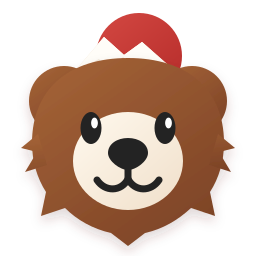

# Kuma Libre — Design system exploratoire

Ce dossier transforme les références visuelles générées en fondations réutilisables pour les maquettes, puis pour la future application.

## Source de vérité

- `styles/tokens.css` contient la palette primitive et les rôles sémantiques, la typographie, les espacements, les rayons et les ombres.
- `styles/tokens.scss` expose des alias SCSS vers les variables CSS, sans recopier les valeurs hexadécimales.
- `styles/fonts.css` charge les fontes des maquettes. En production, elles devront être auto-hébergées.
- `styles/brand.css` fournit le lockup HTML de la marque.
- `assets/kuma-bear.svg` est une adaptation vectorielle propre de la mascotte, et non une vectorisation automatique pixel à pixel.

## Direction retenue

- **Titres et marque** : Fredoka, choisie pour son dessin rond et amical proche de la référence.
- **Interface** : Nunito Sans, plus lisible dans les petits composants et sur mobile.
- **Japonais** : Noto Sans JP.
- **Action principale** : rouge vermillon.
- **Fond** : crème chaud, avec des surfaces presque blanches.
- **Mascotte** : brun caramel, museau crème, montagne et soleil rouge.

La fonte exacte des visuels générés ne peut pas être identifiée avec certitude depuis un PNG. Les choix ci-dessus forment une direction cohérente et utilisable sur le web.

## Utilisation

```html
<link rel="stylesheet" href="../design-system/styles/fonts.css" />
<link rel="stylesheet" href="../design-system/styles/tokens.css" />
<link rel="stylesheet" href="../design-system/styles/brand.css" />

<a class="kl-brand" href="#">
  
  <span class="kl-brand__wordmark">
    <span class="kl-brand__wordmark-kuma">Kuma</span>
    <span class="kl-brand__wordmark-libre">Libre</span>
  </span>
</a>
```

Le SVG contient deux groupes nommés `kuma-eye-left` et `kuma-eye-right`. Ils clignent ensemble par défaut et pourront plus tard être pilotés séparément si la mascotte est injectée en SVG inline dans l’application. L’animation respecte `prefers-reduced-motion`.

